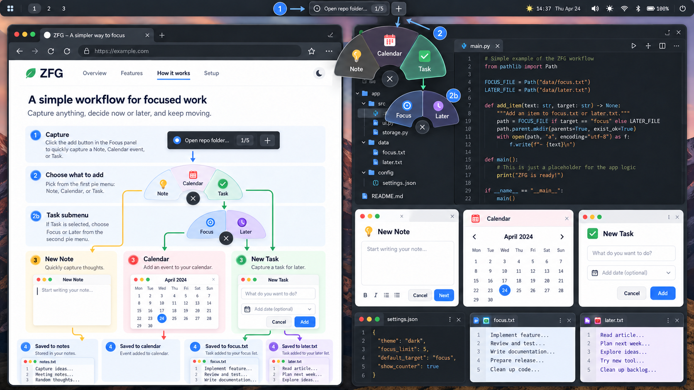

# ZFG

A low-friction Linux capture and routing layer for short Focus and Later task lists.



> **Pre-release Linux build.** Plain-text storage, management/settings windows, EN/RU UI, the live Ryoku widget, nested semicircular menus, reduced-motion-aware fades, outside-click dismissal, and an opt-in portal shortcut are implemented. The native Wayland workflow has been smoke-tested. A sandboxed Flatpak build, interactive portal approval, broad multi-monitor testing, and public release identity remain unverified.

## What it does

- Stores tasks in readable `focus.txt` and `later.txt` files. No database is required.
- Keeps Focus bounded (default 5); replacing a Focus task moves the displaced task to Later.
- Provides CLI status/task operations and GTK windows (`zfg launcher`, `zfg focus`, `zfg later`, `zfg settings`).
- Ships a Ryoku QS Bar plugin with first Focus text, `N/5`, and `+`; it polls the same CLI status used by other adapters.
- Offers configured Note and Calendar URI defaults. Custom commands use argv arrays, not `/bin/sh -c`.

## Quick start

```sh
cargo build --release
cargo run -- task add --focus "Test task"
cargo run -- status --json
cargo run -- launcher
```

Human task indices are 1-based. If Focus is full, adding returns a non-zero exit with a JSON error on stderr. Explicit replacement moves the displaced task into Later.

## Ryoku

See [docs/ryoku.md](docs/ryoku.md). The widget is a separate community plugin and does not edit task files or Ryoku's shipped configuration. Its local source is `ryoku-plugin/zfg-focus/`.

## Data format

`$XDG_DATA_HOME/zfg/` (fallback `~/.local/share/zfg/`) contains UTF-8 `focus.txt` and `later.txt`, one non-empty task per line. `line 1` in Focus is the current top task. Duplicates and order are preserved. New input is trimmed, whitespace-collapsed, and limited to 500 Unicode scalar values without truncation. External changes are reread before operations.

Mutations use an advisory cross-process lock, sibling temporary files, fsync/rename, and a recovery journal for cross-file transfers. The plain-text files remain canonical. Editors that ignore the lock can still race during a mutation.

Configuration is JSON at `$XDG_CONFIG_HOME/zfg/settings.json` (fallback `~/.config/zfg/settings.json`). On malformed JSON, ZFG preserves the original and writes a timestamped backup before using defaults.

## Privacy

No telemetry, accounts, cloud sync, background network access, or task uploads. Opening a configured external URI is user-initiated. See [docs/privacy.md](docs/privacy.md).

## Build and test

Requires Rust edition 2024, GTK4, and gtk4-layer-shell development files. For a user-local install with desktop metadata/icon, run `python3 scripts/install-native.py`; see [native and Flatpak packaging](docs/flatpak.md).

```sh
cargo fmt --check
cargo clippy --all-targets --all-features -- -D warnings
cargo test --locked --all
```

## Roadmap / current limitations

- Verify portal shortcut approval/delivery and sandboxed URI opening on target desktops.
- Test multi-monitor/high-DPI behavior and improve pointer-relative placement where supported.
- Collect daily-use visual feedback and privacy-safe release screenshots.
- Confirm the public name, GitHub owner, app ID, and methodology attribution before release.
- Build the prepared offline-source Flatpak manifest in the SDK, then replace local sources with immutable release sources before Flathub submission.

See [architecture](docs/architecture.md), [integrations](docs/integrations.md), [privacy](docs/privacy.md), and [implementation notes](IMPLEMENTATION_NOTES.md).

## License

MIT. The implementation's authorship does not imply authorship of the underlying methodology.
